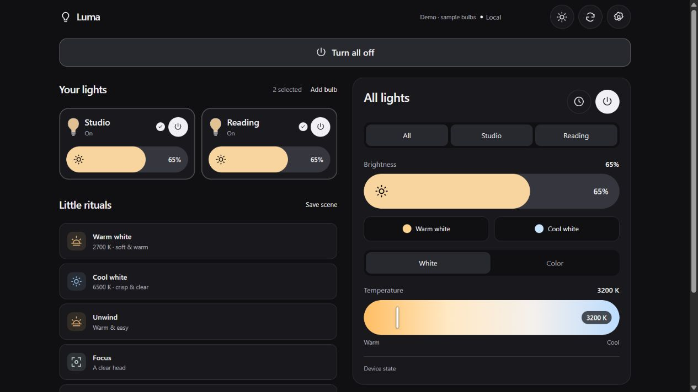
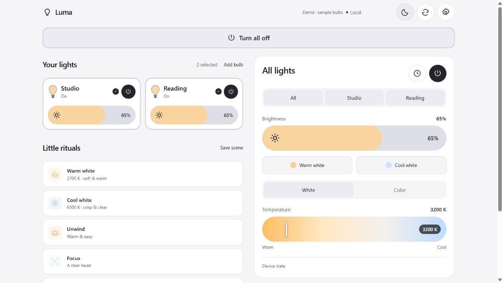
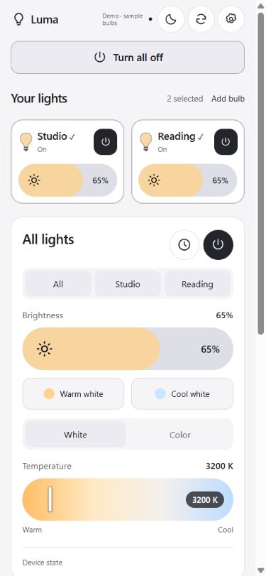
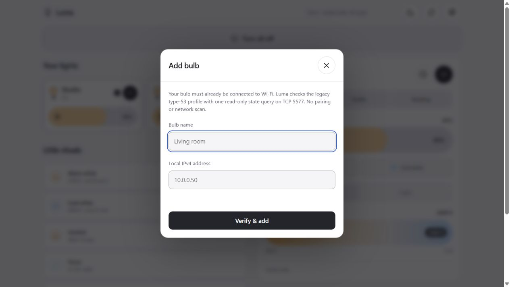

# Luma

A quiet control centre for compatible Wi-Fi lights. Power, color, and brightness stay on your local network, with one interface for your phone and computer.



## Features

- One large button to turn all lights on or off.
- Independently select bulbs and adjust any combination together.
- Touch-friendly brightness, temperature, hue, and saturation sliders.
- Brightness fills that follow the selected bulb colors.
- A color wheel, named colors, and a custom color picker.
- Warm/cool white presets, built-in rituals, and saved scenes.
- Off timers for selected bulbs.
- Add, rename, and remove bulbs in the interface.
- Dark/light themes, responsive layouts, and home-screen icons.
- Live state updates, independent command queues, and no cloud account or frontend build step.

Screenshots show the actual interface using the built-in simulator and sample bulbs, without real installation details.

| Light mode | Phone layout |
| --- | --- |
|  |  |

## Compatibility

Luma implements the **legacy, unwrapped TCP 5577 type-53 RGB + warm/cool-white profile** found in some Briturn / Nowepai and compatible Zengge / MagicHome-style Wi-Fi bulbs. This is a protocol profile; it does not mean every bulb sold under those brands works. Other models may require different framing, authentication, or channel layouts.

Adding a bulb sends one read-only state query and requires a valid checksummed response reporting device type **53 (`0x35`)**. This check does not prove every feature on an unfamiliar model. Try a single bulb first. Unsupported devices are not saved. Luma does not pair bulbs, scan the network, or integrate unrelated smart-home ecosystems.

Bulbs must already be provisioned onto Wi-Fi and reachable from the computer running Luma. Initial setup may require the manufacturer's app. Luma's supported controls then communicate directly with the bulb, without a manufacturer account or cloud API.

## Run locally

Install **Node.js 20 or later** and Git:

```sh
git clone https://github.com/Syst4n/Luma.git
cd Luma
npm start
```

Open **http://localhost:3777**. There are no runtime dependencies to install. Keep the terminal and computer running while using Luma. Stop with `Ctrl+C`.

To explore with simulated bulbs and no physical device access:

```sh
npm run demo
```

Stop the normal server first if it uses the same port. Demo mode runs the actual interface against simulated bulbs, never opens bulb sockets, and does not save configuration. A visible badge identifies it.

### Access from your phone or another computer

The default server listens only on the host computer. To allow access from your trusted LAN, stop it and restart with:

**Windows PowerShell**

```powershell
$env:LUMA_HOST = '0.0.0.0'
npm start
```

**macOS / Linux**

```sh
LUMA_HOST=0.0.0.0 npm start
```

The terminal prints available LAN URLs. Open the appropriate `http://<computer-LAN-IP>:3777` address from your iPhone, Android device, Mac, or Windows computer on the same network. With multiple interfaces, choose the one your device can reach. Allow Node.js through the host firewall on your trusted private network if needed. Guest Wi-Fi or client isolation can block access.

On iPhone Safari, choose **Share → Add to Home Screen**. On Android, use the browser's home-screen shortcut option. The host must stay awake; the shortcut does not replace the backend or provide offline control.

Luma has no login or TLS layer. Anyone who can reach its server can read registered bulb addresses and control them. Use it only on a trusted LAN; do not port-forward it or expose it to the internet.

## Add your bulbs

1. Connect the bulb to Wi-Fi using its normal setup process.
2. Find its current IPv4 address in your router's connected-device / DHCP list or the manufacturer's app. A DHCP reservation helps keep it stable.
3. Select **Add bulb** under **Your lights**.
4. Enter a name and private LAN IPv4 address, then choose **Verify & add**.
5. Luma queries that one address on TCP 5577. A matching response adds it to the control centre. Adding it sends no power, color, or brightness command.



Accepted addresses are in `10.0.0.0/8`, `172.16.0.0/12`, or `192.168.0.0/16`. Luma does not assume a `/24` subnet. Public addresses, hostnames, loopback, and IPv6 are unsupported. The backend needs a working route to the bulb.

Tap each bulb card to select or deselect it. Selected bulbs share the main controls; each card also has its own power and brightness controls. Changing color or brightness turns an off bulb on. **Turn all on/off** always affects every registered bulb, regardless of selection.

Open **Settings** to rename or remove bulbs. Removal forgets the registration without resetting or changing the bulb. If its address changes, remove it and add the new address.

A saved scene captures all bulbs registered at the time; applying it affects selected bulbs included in that scene. Built-in rituals apply to any selected bulb. Re-added bulbs have new identities and do not inherit old scene membership.

Off timers run in the backend and clear when it stops or a targeted bulb is removed. Keep the host running until the timer finishes.

## How it works

```text
Browser  ← HTTP + live events →  Local Node.js backend  ← TCP 5577 →  Registered bulbs
```

Each bulb has an independent command queue. Intermediate slider updates collapse to the latest value, so a slow bulb does not hold up another. The transport spaces adjacent frames by at least 40 ms and reuses short-lived TCP connections.

With a browser connected, the backend requests state approximately every 2.5 seconds. A successful socket write means the command was sent, not that the physical light applied it. Luma gives a recent setting up to five seconds to settle before reporting a persistent mismatch. Displayed write timings measure software/socket completion, not physical light response.

Startup restores configuration without replaying power or color commands. Browsers share backend state; conflicting actions use the latest received setting. Names and scenes live on the host; the theme preference lives in each browser.

See [the supported protocol](docs/protocol.md) for packet details.

## Local data and configuration

Luma creates `data/settings.json` after configuration changes. It contains bulb names, IP addresses, scenes, and remembered level/color settings. Git ignores this directory. New checkouts contain no configured bulbs. There is no telemetry, analytics, external font request, or cloud credential requirement.

| Variable | Default | Purpose |
| --- | --- | --- |
| `LUMA_HOST` | `127.0.0.1` | HTTP interface; `0.0.0.0` allows LAN access. |
| `LUMA_PORT` | `3777` | HTTP port. |
| `LUMA_DATA_DIR` | Project's `data/` directory | Private local settings location. |
| `LUMA_SOURCE_IP` | OS-selected interface | Optional local IPv4 source for bulb connections on multi-interface hosts. |

Keep personal configuration outside version control, especially when choosing a custom data directory.

## Troubleshooting

- **Cannot add a bulb:** confirm its current IP, Wi-Fi provisioning, local route, and TCP 5577 accessibility. A timeout or unsupported type is not a reason to try arbitrary control frames.
- **Phone cannot reach Luma:** check the LAN listening setting, computer wake state, URL, firewall, and Wi-Fi isolation.
- **A slider later changes value:** inspect its status. Luma eventually reports device state when the bulb does not confirm the requested setting. Another controller can also change it.
- **Colors or white channels look wrong:** the model may differ from this profile; check its protocol before extending the driver.
- **Port already in use:** stop the other instance or change `LUMA_PORT`.

## Development and updates

```sh
npm test
```

Tests cover packet encoding, checksums, slider queues, delayed state confirmation, registration, persistence, and API restrictions. They use synthetic state and simulated transports rather than physical bulbs.

The interface is plain HTML/CSS/JavaScript. `src/protocol.mjs` handles packets, `src/bulbs.mjs` manages transport and state, and `server.mjs` provides the local API. Future product profiles can be added as explicit drivers.

To update, stop Luma, run `git pull --ff-only`, and restart it. Your ignored `data/` directory stays local; back it up separately to preserve your setup.
